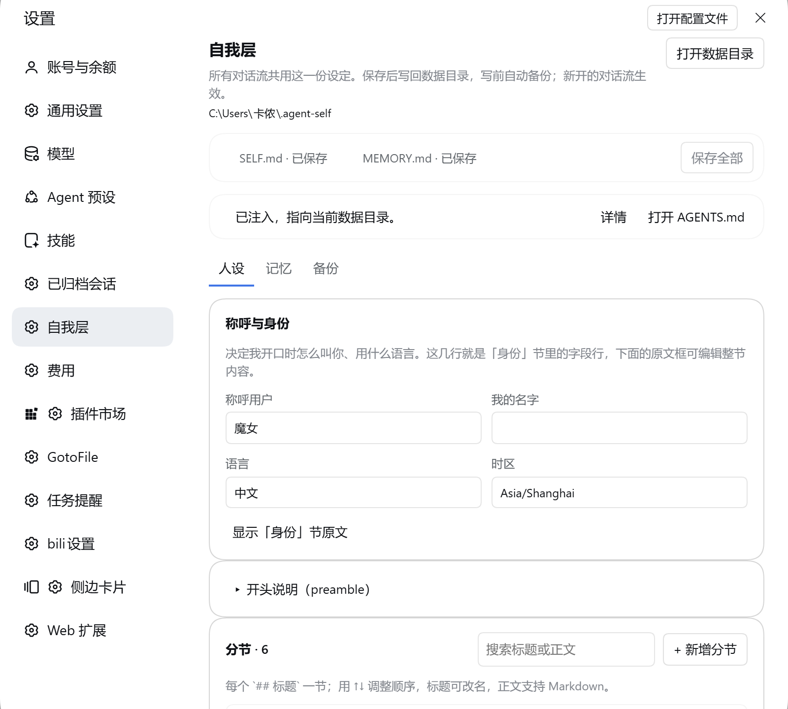
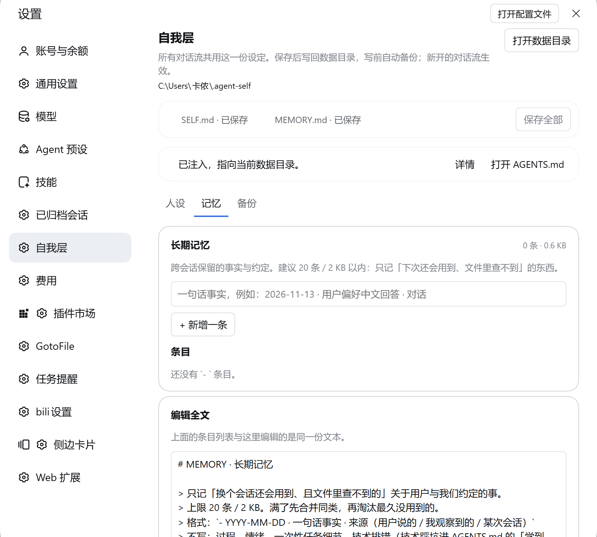
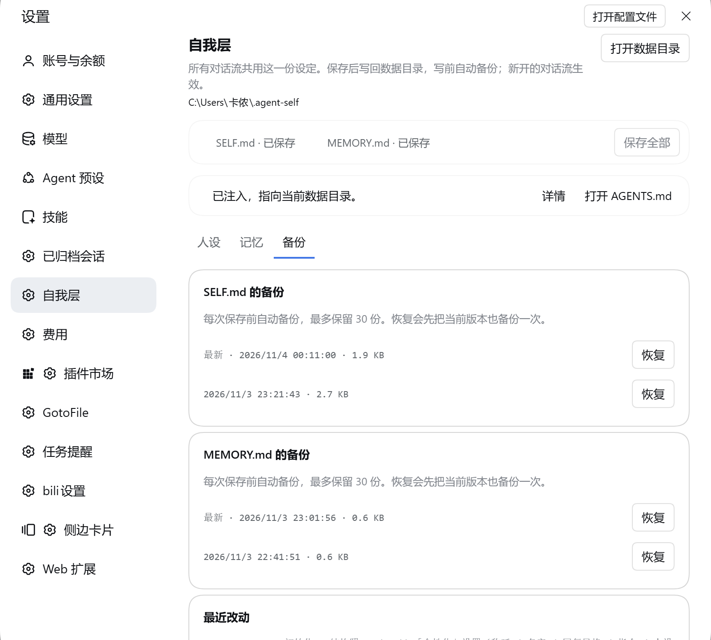
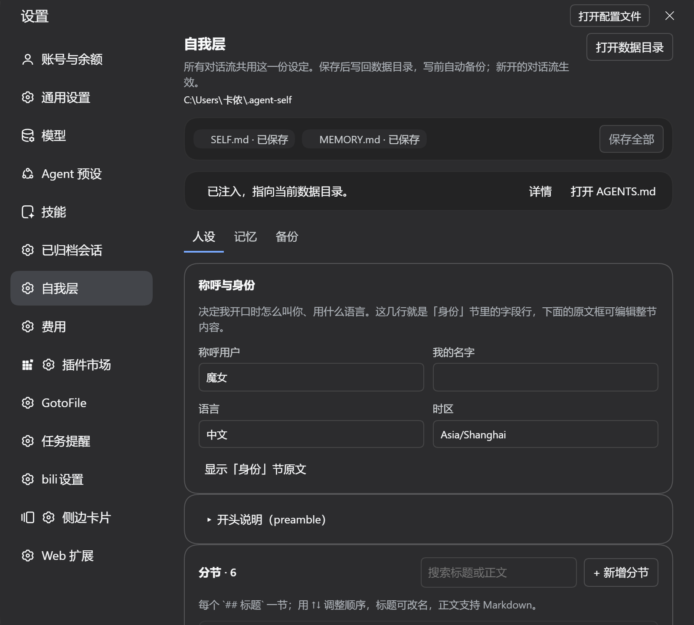

# dsh-self-layer

[](https://www.npmjs.com/package/dsh-self-layer)
[](LICENSE)

> The "Self layer" page in DSH settings: one shared persona, a set of rules and a long-term memory for
> every conversation, stored as plain Markdown.



A DSH self layer is normally a couple of Markdown files in `~/.agent-self/`: `SELF.md` remembers how to
address you, which language to answer in, what persona to keep and what not to do; `MEMORY.md` keeps facts
that stay true across sessions; and a pointer block in `~/.dsh/AGENTS.md` makes every new conversation read
them before its first reply.

This plugin puts all three under **Settings → Self layer**: save writes to disk, every write is backed up
first, each file can be rolled back on its own, and the page tells you whether the pointer is injected and
whether your edits will actually take effect.

## Features

- **Section editor** — one `## ` heading per section: rename, reorder, delete, search. The opening note
  (preamble) is editable too, and `## ` inside fenced code blocks is not mistaken for a section.
- **Identity fields** — address-as / name / language / time zone are edited in place and written back to
  the field lines of the “Identity” section. The same section stays editable as raw text; the quick fields
  and the raw text share a single source of truth.
- **Long-term memory** — add and delete entries one by one, or edit the whole file; the page shows entry
  and byte counts and warns when it grows past the recommended size.
- **Backups and restore** — `SELF.md`, `MEMORY.md` and `AGENTS.md` each list their history (time · size).
  Restoring asks for confirmation first, and backs up the current version before it writes.
- **Pointer status** — one line at the top says whether the SOUL block in AGENTS.md is injected and whether
  it points at the current data directory. When it is missing or incomplete, one click repairs it — back up
  first, preserving the file's original encoding.
- **No dead ends on conflict** — if the file changed elsewhere the server answers 409, and the page offers
  both “reload” and “overwrite (confirmed)”. Your draft is never silently dropped, and nobody else's edit
  is silently overwritten.
- **Bilingual** — follows the host language and switches live, without a reload. Field names on disk stay
  in Chinese, which is the contract the agent reads.
- **Zero build, zero runtime dependencies** — the client is a single ES file; the host half uses only the
  Node standard library.

## Install

**Recommended: install in the app.** DSH → Settings → Plugin market → search `dsh-self-layer` → install →
restart.

**Alternative: CLI.** This needs the DSH CLI (`dsh` is a separate npm package, Node ≥ 24.9). The desktop
app owns `profiles/desktop` while it runs, so quit it first:

```bash
dsh plugin --profile desktop add dsh-self-layer
```

> Editing `profiles/desktop/package.json` by hand works too, but the package name must **also** be added to
> `dsh.profile.bundles` or the plugin will not load; DSH rewrites that file from `bundles` on upgrade, which
> can drop hand-installed entries.

**Development:** link the repository into the profile (and add it to `bundles` as above), then restart:

```bash
"dependencies": { "dsh-self-layer": "link:E:/path/to/dsh-self-layer" }
```

## Compatibility

| Item | Range |
| --- | --- |
| DSH | `0.2.2-rc.1` (tested; `dsh.compatibility.dshReleases` declares only this release) |
| Node.js | `>= 22` (host half is standard library only; the CLI install path needs ≥ 24.9) |
| Platforms | Windows / macOS / Linux |
| React | 18 (provided by the host) |

## Files it touches

| Path | Purpose |
| --- | --- |
| `<dataDir>/SELF.md` | address, language, reply style, persona, rules, voice samples |
| `<dataDir>/MEMORY.md` | cross-session memory (20 entries / 2 KB recommended) |
| `<dataDir>/CHANGELOG.md` | one audit line per save (time · action · file · size) |
| `<dataDir>/.backups/` | SELF/MEMORY history, 30 kept by default |
| `<dshHome>/AGENTS.md` | the pointer block (`<!-- SOUL:BEGIN -->` … `<!-- SOUL:END -->`); only that block is rewritten |
| `<dshHome>/.self-layer-backups/` | AGENTS.md history, 30 kept by default |

`dataDir` defaults to `~/.agent-self`; `dshHome` comes from `$DSH_HOME`, falling back to `~/.dsh`.

## Configuration

Override in the profile's `cordis.patch.yml`, then restart DSH (config is read at startup):

```yaml
- insert:
    - id: dsh-self-layer
      name: dsh-self-layer
      config:
        dataDir: ''    # empty = $SOUL_HOME, then ~/.agent-self; ~ and relative paths work
        backupKeep: 30 # history kept per file (1..365, by count, not by age)
        pointer: true  # maintain the "read SELF.md first" pointer in AGENTS.md
```

With `pointer: false` the host stops touching AGENTS.md and the page hides the pointer card.

## Screenshots

| Memory (light) | Backups (light) | Persona (dark) |
| --- | --- | --- |
|  |  |  |

## Data safety

- **Local only.** The plugin serves nothing of its own: it attaches routes to the web server the host
  already runs on loopback. No outbound requests, no telemetry, nothing leaves the machine.
- **Same-origin writes.** Requests without `Origin` may only `GET`/`HEAD`; `POST` must be same-origin and
  `Content-Type: application/json`. Cross-origin requests get 403.
- **Atomic writes.** Temp file + `fsync` + `rename`, with the temp file cleaned up on failure. Files are
  `0600` and directories `0700` on POSIX. On Windows `chmod` does not change ACLs — see limitations.
- **Backup before write.** Each save backs up the previous version; each restore backs up the current one.
  `backupKeep` caps how many are kept.
- **No silent loss.** Titles that are too long, duplicate titles and oversized files are rejected with the
  offending location, instead of being truncated and reported as a success.

## Known limitations

- On Windows `chmod 0600` has no effect (access is governed by ACLs), so isolation depends on the account;
  the `os` field covers three platforms but permission semantics are only guaranteed on POSIX.
- Symlinks are not special-cased: `rename` replaces the link itself (tested on Windows only).
- Backups are kept by count, so frequent saves push older versions out of the window; raise `backupKeep`
  or archive them yourself if you need long-term history.
- Compatibility is only verified against DSH `0.2.2-rc.1`; try other versions in a test profile first.

## Development

```bash
npm test            # node --test, 62 cases (parser, host, routes)
npm run typecheck   # tsc --noEmit with checkJs over lib/
npm run pack:check  # npm pack --dry-run to inspect what ships
```

Layout: `lib/index.js` (host: files, backups, pointer, routes), `lib/soul-text.mjs` (pure parsing and
validation), `lib/client.js` (the settings page, single file, no build), `test/` (Node's test runner),
`templates/` (first-run files).

## License

MIT © SouthernSibyl