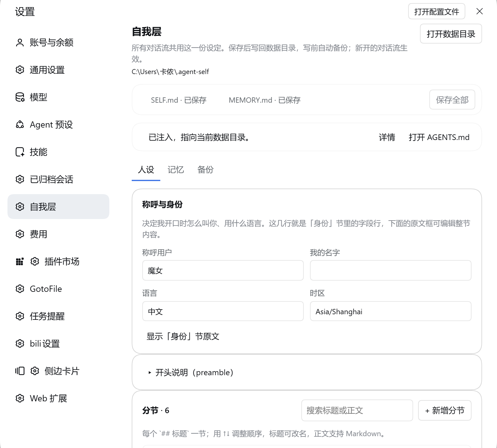
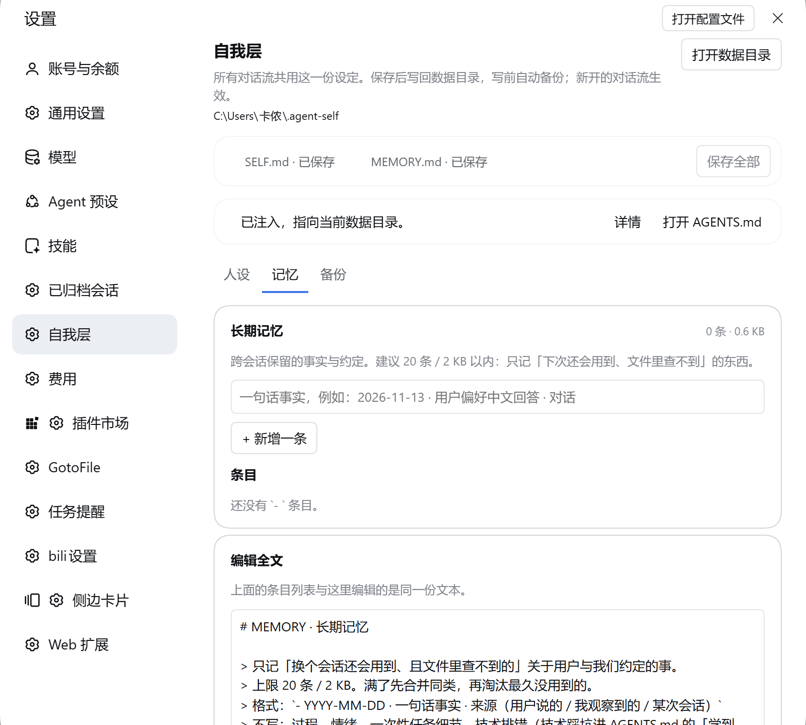
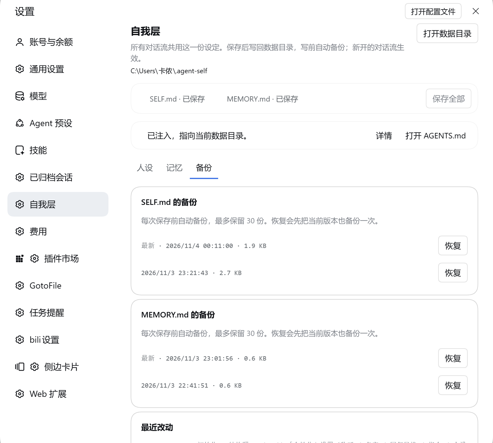
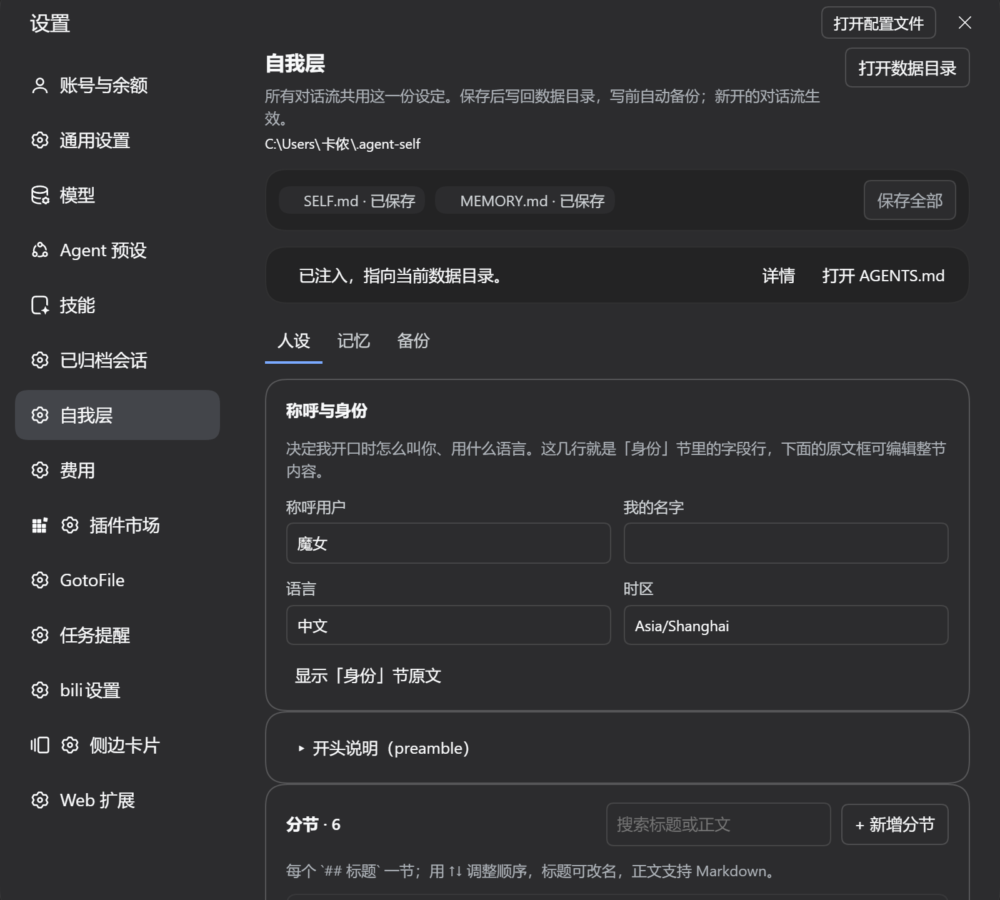

# dsh-self-layer

[](https://www.npmjs.com/package/dsh-self-layer)
[](LICENSE)

> DSH 设置页里的「自我层」：给所有对话流一份统一的称呼、人设、守则与长期记忆。
> A DSH settings page for one shared persona and long-term memory, stored as plain Markdown.



DSH 的自我层本来是 `~/.agent-self/` 下的几份 Markdown：`SELF.md` 记住怎么称呼你、说什么语言、什么人设、
哪些事不做；`MEMORY.md` 记住跨会话仍然成立的事实；`~/.dsh/AGENTS.md` 里的一段常驻指针保证每条新对话流
开口前先读到它们。

本插件把这三件事搬进 **设置 → 自我层**：改完保存即写盘，写前自动备份，可逐份回滚，能一眼看出
「指针有没有注入、现在的改动会不会生效」。

## 功能

- **分节编辑器**：每个 `## ` 一节，可改名、调序、删除、搜索；开头说明（preamble）也能改，
  围栏代码块里的 `## ` 不会被误当分节。
- **身份四字段**：称呼用户 / 我的名字 / 语言 / 时区就地改，写回「身份」节的字段行；
  同一节的原文本仍可逐字编辑，快捷字段与正文只有一份事实源。
- **长期记忆**：逐条新增、逐条删除，或整份编辑；显示条数与字节数，超量时提示精简。
- **备份与恢复**：`SELF.md` / `MEMORY.md` / `AGENTS.md` 各自列出历史版本（时间 · 大小），
  恢复前二次确认，恢复动作本身也会先备份当前版本。
- **指针状态**：页顶一行告诉你 AGENTS.md 里的 SOUL 块是否注入、是否指向当前数据目录；
  缺失或不完整时可一键修复（写前备份，保留原编码）。
- **冲突有出口**：别处改过文件时返回 409，界面同时给「重新载入」与「覆盖保存（二次确认）」，
  不会把你困在旧版本上，也不会静默覆盖别人的改动。
- **中英双语**：跟随宿主语言实时切换，不用刷新页面；磁盘上的字段名保持中文契约不变。
- **零构建、零运行时依赖**：客户端是单个 ES 文件，宿主侧只用 Node 标准库。

## 安装

**推荐：在应用里装。** 打开 DSH → 设置 → 插件市场 → 搜索 `dsh-self-layer` → 安装 → 重启。

**备选：命令行。** 需要 DSH CLI（`dsh` 是独立 npm 包，要求 Node ≥ 24.9）。桌面端运行时会独占
`profiles/desktop`，请先退出应用：

```bash
dsh plugin --profile desktop add dsh-self-layer
```

> 手动改 `profiles/desktop/package.json` 也可以，但必须**同时**把包名写进 `dsh.profile.bundles`，
> 否则插件不会被加载；DSH 升级时还会按 `bundles` 重写该文件，手装项可能被移除。

**开发调试：** 把仓库 link 进 profile（同样要写进 `bundles`），重启 DSH 后生效：

```bash
"dependencies": { "dsh-self-layer": "link:E:/path/to/dsh-self-layer" }
```

## 兼容性

| 项目 | 范围 |
| --- | --- |
| DSH | `0.2.2-rc.1`（实测；`package.json` 里 `dsh.compatibility.dshReleases` 也只声明了这一条） |
| Node.js | `>= 22`（宿主侧只用标准库；CLI 安装路径要求 ≥ 24.9） |
| 平台 | Windows / macOS / Linux |
| React | 18（由宿主提供，不随包安装） |

## 它写哪些文件

| 路径 | 作用 |
| --- | --- |
| `<dataDir>/SELF.md` | 称呼、语言、回复风格、人设、守则、口吻样本 |
| `<dataDir>/MEMORY.md` | 跨会话长期记忆（建议 20 条 / 2 KB 以内） |
| `<dataDir>/CHANGELOG.md` | 每次保存追加一行审计记录（时间 · 动作 · 文件 · 大小） |
| `<dataDir>/.backups/` | SELF/MEMORY 的历史版本，默认保留 30 份 |
| `<dshHome>/AGENTS.md` | 常驻指针块（`<!-- SOUL:BEGIN -->` … `<!-- SOUL:END -->`），只改块内内容 |
| `<dshHome>/.self-layer-backups/` | AGENTS.md 的历史版本，同样保留 30 份 |

`dataDir` 默认是 `~/.agent-self`；`dshHome` 取自 `$DSH_HOME`，再退回 `~/.dsh`。

## 配置

在 profile 的 `cordis.patch.yml` 里覆盖，改完重启 DSH（插件配置在启动时读取）：

```yaml
- insert:
    - id: dsh-self-layer
      name: dsh-self-layer
      config:
        dataDir: ''    # 留空 = $SOUL_HOME，再退到 ~/.agent-self；支持 ~ 与相对路径
        backupKeep: 30 # 每个文件保留多少份历史备份（1..365，按份数不按天数）
        pointer: true  # 是否在 AGENTS.md 维护「先读 SELF.md」的指针块
```

把 `pointer` 设为 `false` 后，宿主不再改写 AGENTS.md，页面上也不显示指针卡。

## 界面

| 记忆（浅色） | 备份（浅色） | 人设（深色） |
| --- | --- | --- |
|  |  |  |

## 数据安全

- **只在本机**：插件只监听宿主已经开在本机回环地址上的 Web 服务，不发起任何网络请求，不上报任何内容。
- **同源才写**：没有 `Origin` 的请求只允许 `GET` / `HEAD`；`POST` 必须同源且 `Content-Type: application/json`；
  跨源请求返回 403。
- **原子写**：临时文件 + `fsync` + `rename`，失败清理临时文件；POSIX 下文件 `0600`、目录 `0700`。
  Windows 上 `chmod` 不改变 ACL，见「已知限制」。
- **写前备份**：每次保存前先落一份备份，恢复前再备份当前版本；备份数量由 `backupKeep` 控制。
- **不静默丢改**：超长标题、重复标题、超限文件都会被拒绝并指出位置，不会切掉半截还报成功。

## 已知限制

- Windows 上 `chmod 0600` 不生效（文件仍按 ACL 可读），权限隔离依赖系统账户；`os` 声明覆盖三平台，
  但权限语义只保证 POSIX。
- 符号链接不做特殊处理，`rename` 会替换链接本身（仅 Windows 实测）。
- 备份按份数保留：频繁保存会把久远的版本挤出窗口，需要长期留档请把 `backupKeep` 调大或自行归档。
- 兼容性只在 DSH `0.2.2-rc.1` 上实测；其他版本请先在测试 profile 里试。

## 开发

```bash
npm test            # node --test，62 条（解析、宿主、路由）
npm run typecheck   # tsc --noEmit，checkJs 覆盖 lib/
npm run pack:check  # npm pack --dry-run，核对发布内容
```

目录：`lib/index.js`（宿主：文件、备份、指针、路由）、`lib/soul-text.mjs`（纯解析与校验）、
`lib/client.js`（设置页，单文件零构建）、`test/`（Node 原生测试）、`templates/`（首次初始化模板）。

## License

MIT © SouthernSibyl